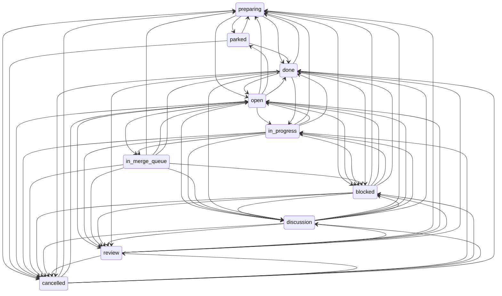
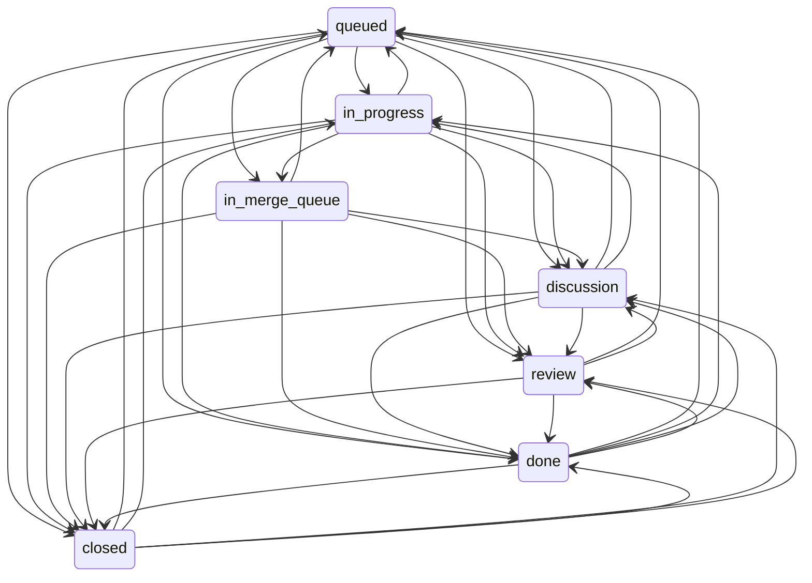
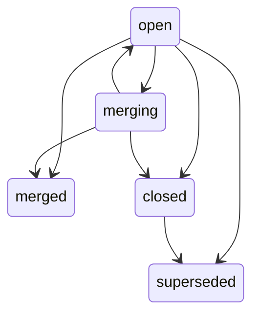
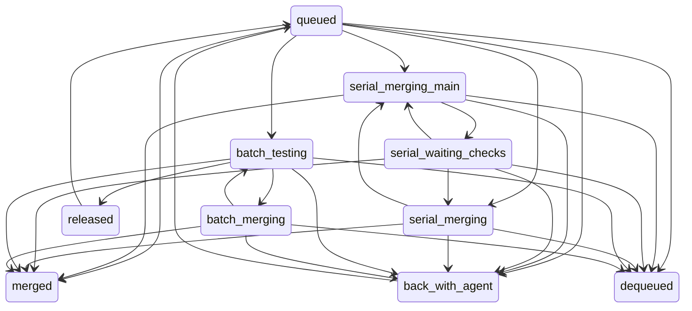

# State machines

Each diagram is generated from the transition table named under it, and a
test fails when the two differ. After changing a table, rewrite them with
`UPDATE_DOCS=1 go test -p 1 -run Diagram ./internal/ticket ./internal/change ./internal/landing`
(`-p 1`: the three packages write this one file).

## Ticket

Every move of a ticket's status, by any route (a person, the claim, an agent
leaving its lease). Table: `ticketTransitions` in `internal/ticket/states.go`.

<!-- state-diagram:ticket -->

<!-- /state-diagram:ticket -->

## Attempt

One attempt at a ticket. Table: `attemptTransitions` in
`internal/ticket/states.go`.

<!-- state-diagram:attempt -->

<!-- /state-diagram:attempt -->

## Landing

A change's landing, from finished work to merged. Table:
`landingTransitions` in `internal/change/landing_state.go`.

<!-- state-diagram:landing -->

<!-- /state-diagram:landing -->

## Landing queue entry

An entry in the merge queue, by phase. Table: `transitions` in
`internal/landing/states.go`.

<!-- state-diagram:landing_queue_entry -->

<!-- /state-diagram:landing_queue_entry -->
